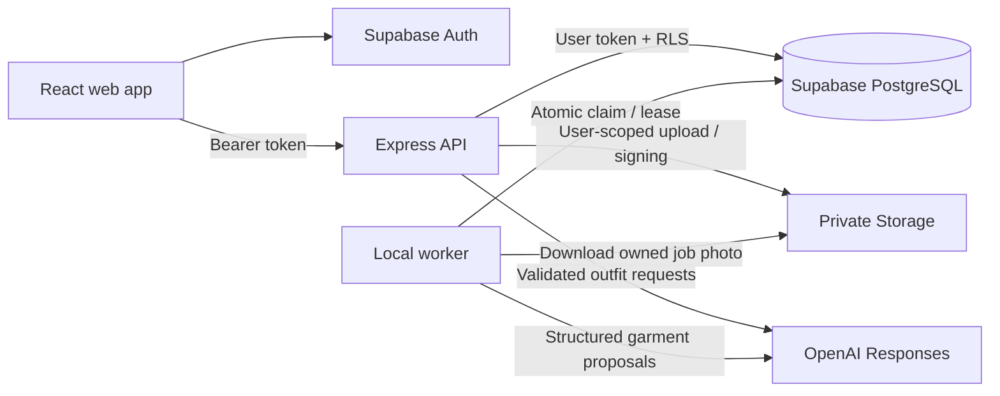

# Architecture and security decisions

## Navigation/inventory extension

The existing browser/API/provider boundaries remain. The forward update adds nullable photos, manually entered metadata, quantities/packs/sets, item favorites and optional profile preferences. Quantities default to unknown, including on existing records. Collection associations prevent duplicating one physical item solely to place it in different collections.

The reviewed-source manifest is file-backed; importing is an explicit authenticated action. A persistent `(user_id, import_id, source_key)` ledger, per-key transaction locking and a unique key prevent repeated/concurrent import duplication. Linking existing inventory adds collections without overwriting its metadata. Ledger tombstones survive item/template deletion. Batches contain at most ten entries; each entry is an independent atomic operation and reports failure without rolling back earlier successful entries. The browser does not automatically retry writes.

Manual finished outfits are distinct from strict AI suggestions. Manual saves validate 1–20 distinct owned confirmed records plus explicit completeness confirmation. AI keeps a supported clothing coverage/shoes rule; sets qualify only after explicit coverage review. SQL invoker functions lock inventory and save/update associations atomically. Editing retains wear-log/feedback records. Templates and nullable component references are separate from completed outfits and cannot themselves be worn. Deleted referenced inventory leaves missing template slots.

The worker, three-attempt leases, fencing and manual-review cancellation remain. No-photo jobs are rejected both at enqueue and by a database trigger; the worker checks for a photo again. Adding a photo to a reviewed text record never resets its status or starts provider processing. New tables have owner RLS, explicit grants and composite owner foreign keys. Source/schema helpers never receive a privileged frontend key.

Today reads a maintained curated-source catalog, not private wardrobe images or a live trends feed. Checked dates are stored research facts, not generated on request. Publisher links and publication dates are documented in `inspiration-sources.md`. No retailer images, analytics or staff wardrobe access feature is introduced.

Before the update is applied, an authenticated capability check disables new persistent features, while a legacy inventory read/tag-review path preserves existing functionality. The configured project now has the approved update at version `20261019182024`; its capability marker returns `1`. The saved-outfit API normalizes PostgREST's single feedback object/null to the established feedback-array contract. Original migration semantics below describe the baseline; the extension above supersedes its photo-required and outfit-shape assumptions where explicitly stated.

The React browser client signs in directly with Supabase Auth. It sends the current access token to Express. Every protected route validates the token with `auth.getUser(token)`, then creates a Supabase client using that user's token. Queries include the authenticated owner ID and pass through PostgreSQL RLS. The separately launched worker is the only application component that uses the privileged Supabase client.

## Photo and review lifecycle

The API checks MIME type and byte size, decodes the image with Sharp under a 25-megapixel limit, rejects mismatched/animated formats, applies orientation, strips metadata, resizes to at most 1,600 × 1,600 and encodes WebP. A draft record owns the deterministic path `<user_id>/<item_id>.webp`. The bucket is private; owner folder policies apply to reads, uploads and deletes. No public URLs are used for wardrobe photos.

The owner explicitly requests AI analysis. An active-job unique index makes enqueue idempotent. A worker claims one persistent job with `FOR UPDATE SKIP LOCKED`; it records a random lease token and a 180-second lease. AI calls have a 60-second timeout and no SDK retries. The database alone counts attempts, so network/worker restarts cannot reset the three-claim bound. Retry delay is `5 × 2^attempts` seconds. A crashed third lease becomes terminally failed on the next poll.

The worker sends normalized image bytes to OpenAI over its SDK, validates structured proposals with Zod, then completes the job transactionally. The RPC verifies the current lease token, expiry and pending item status before inserting a suggestion. The proposal does not mutate reviewed garment tags. Manual confirmation locks the item and cancels active jobs, preventing late AI results from overwriting the user's review. Confirmed garments need a nonempty name/color and a supported category. There are no inferred size, material, fit, brand or ownership fields.

Deleting the browser tab does not delete a draft or job. Pending garments remain in the closet and can be reviewed later. A missing AI key/model/worker produces setup or queue guidance and leaves manual review available.

## Recommendations and saving

Only confirmed inventory is sent to the outfit model, with IDs and reviewed tags; photos and user profile identifiers are excluded. User names, style preferences and image text are treated as untrusted data in prompts. The AI has no tools or authority to change records.

A complete look has exactly one shoes item, plus either one dress or one top with one bottom, with at most one optional layer and accessory. Capacity counts distinct supported combinations, including optional outerwear/accessory variants. The API requests `min(3, capacity)` suggestions or returns an honest insufficient-inventory note without calling AI. Preferences and season are guidance; the app does not infer fabric warmth or current weather.

The API rejects unknown, foreign, pending, duplicate and incomplete garment sets and duplicate suggestions. It re-reads inventory after model latency. The frontend independently validates IDs against its own current inventory before rendering suggestions. Saving rechecks the IDs at the API and calls an atomic, security-invoker PostgreSQL RPC that locks inventory rows and inserts both outfit and associations. Composite owner foreign keys and a confirmed-item trigger reject direct cross-account or pending-item links too.

Wear logs require an owned saved look, an explicit user action and a non-future date. Database constraints also protect dates and prevent duplicate wears for the same outfit/day. Feedback is one editable 1–5 rating/comment per owner/outfit. Removing a garment invalidates affected saved looks before deleting associations, preserving their wear records while preventing new wears. Removing an outfit cascades its feedback and wear logs after UI confirmation.

## Privileges, privacy and error boundaries

- All eight tables have RLS. Profile access is by Auth ID; other records use `user_id = (select auth.uid())`. UPDATE policies include both `USING` and `WITH CHECK`, and owner columns cannot be reassigned.
- The server never trusts a body-supplied owner, unverified browser session, or user-editable JWT metadata for authorization.
- Worker claim/finish functions are service-role only. Public user RPCs use invoker rights. Elevated functions are confined to private trigger functions for Auth profile creation and item/job invalidation; direct execution is revoked.
- Photo access uses five-minute signed URLs; responses use `Cache-Control: no-store`, and images use a no-referrer policy. URLs are temporary bearer capabilities and should not be shared. The UI refreshes data every four minutes and provides a manual Refresh wardrobe action. Browser API requests have a 90-second timeout and never retry writes automatically.
- Express uses Helmet, an explicit local CORS origin, bounded JSON/multipart payloads, a request rate limit and stricter AI limits. Limits are process-local in this local phase.
- Only URL and publishable key enter the browser bundle. OpenAI and privileged Supabase credentials remain server-side. Provider errors are never serialized or logged, avoiding accidental image/key/URL disclosure.
- `store: false` is set on OpenAI requests. This does not replace the provider's data-use/retention terms. Users choose when to send a photo for analysis.
- Sign-out clears the SDK session and unmounts private UI state. Existing access tokens may remain usable until expiry under Supabase's token semantics; short access-token lifetimes and production session revocation policy need live security review.

## Local phase limitations

Database/Storage writes cannot share an atomic transaction. A failed upload attempts to remove its draft; an upload that succeeds but cannot be signed remains a recoverable draft. Photo deletion runs before record deletion: if the database step fails, retrying deletion is supported, but that row may temporarily have a missing image. Concurrent upload/delete or a process crash can leave orphaned bytes. A future reconciliation job should compare private object paths to item records. No cleanup job claims to exist yet.

The interface reads at most 1,000 garment records and 500 outfits/wears. Outfit generation stops above 500 confirmed garments. The local worker is intended for trusted developer use; a malicious authenticated user calling the Data API directly could enqueue many jobs for their own account. Production needs database quotas, spend controls and distributed rate limiting. No payments, live weather, social sharing, background removal or telemetry dashboard is included.

## Future AWS plan

This is the workshop's proposed next phase, not a deployed or verified system:

1. Retain `ai_tag_jobs` and the tested ownership/review contracts as the durable source of truth.
2. Introduce reliable queue publication (for example a transactional outbox) and SQS delivery; carry job IDs, not photos or credentials, in messages.
3. Move processing to Lambda with visibility/lease timing aligned to model timeouts, idempotent completion, bounded retries and a dead-letter queue. Re-test concurrency and duplicate delivery.
4. Build versioned application containers, store images in ECR, and evaluate the workshop's Elastic Beanstalk Docker target after checking account eligibility and regional constraints.
5. Add GitHub Actions validation and an explicitly authorized deployment phase, HTTPS, health checks, rollback, least-privilege roles, managed secrets and CloudWatch with sanitized logs.
6. Run live ownership tests and a real pilot before claiming the specification's acceptance metrics. Pilot completion, recognition accuracy, costs, tester feedback and development time are not measured here.

Recheck official AWS documentation and pricing when that phase starts. No AWS resources, credentials, network changes or deployments were created in this local implementation.
